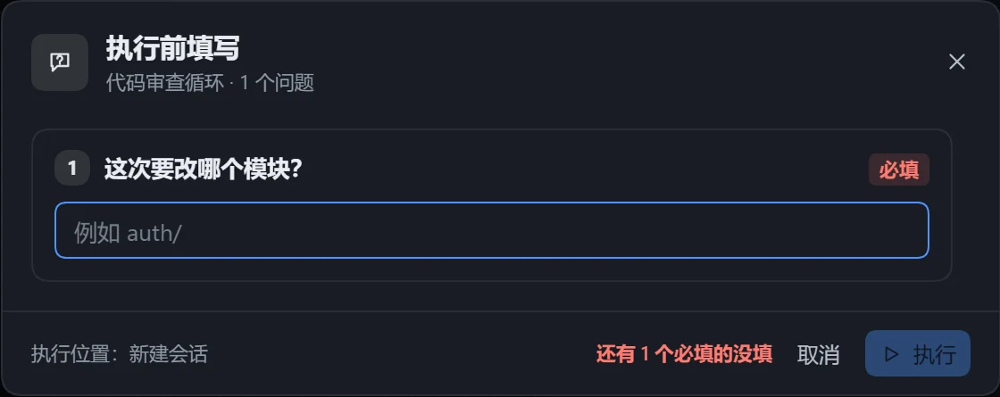
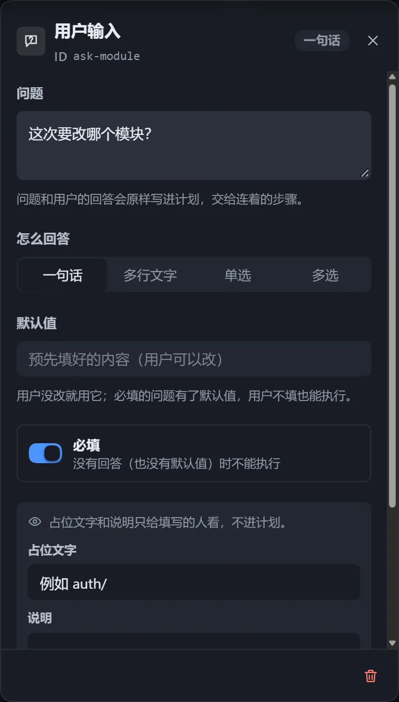

「用户输入」节点在执行前提一个问题，填空或选择均可，回答原样写进计划。适合每次都会变的信息，如要处理的模块、审查的严格程度。

## 使用

1. 从步骤库「基础」拖出「用户输入」，或在画布空白处右键添加。
2. 在右侧面板写问题，选回答方式。
3. 从输入卡右侧的点拖一条线到需要这个回答的步骤。
4. 点击「执行」，在「执行前填写」窗口填好后点击「执行」，或按 Ctrl+Enter。

## 配置项

| 配置项 | 说明 |
|---|---|
| 问题 | 不能换行；要多说几句写在「说明」里。 |
| 怎么回答 | 一句话、多行文字、单选、多选。 |
| 选项 | 单选、多选用，最多 30 个。 |
| 默认值 | 用户没改时使用；有默认值的必填题可以直接执行。 |
| 占位文字、说明 | 只给填写的人看，不写进计划。 |
| 必填 | 开启后，没有回答也没有默认值时不能执行。 |
| 允许自己填写 | 单选、多选用，增加「其他」一行，计划里注明「（用户自填）」。 |

## 注意

- 输入卡连到哪些步骤，就只有这些步骤看到回答；不连线则所有步骤都能看到。
- 实例里可以查看用户的回答，没填写显示「没有填写」。
