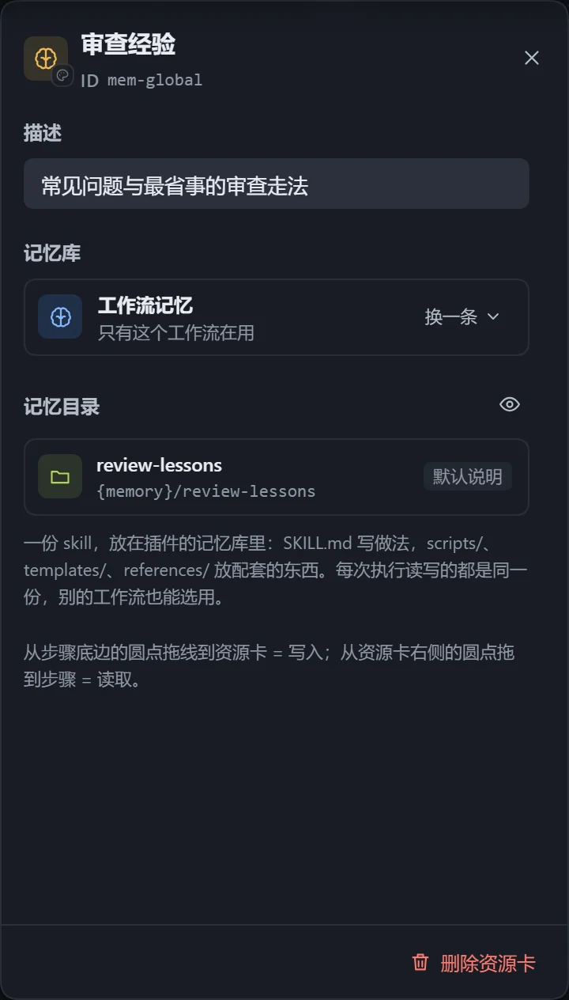
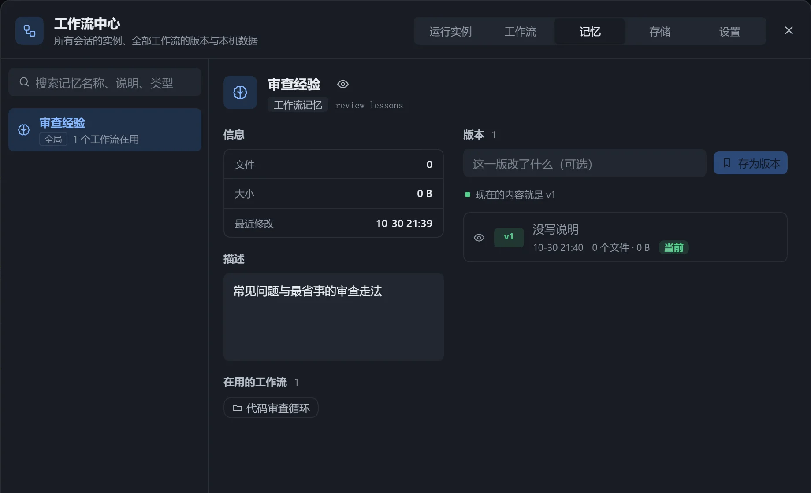

:::caution[实验性功能]
行为和数据格式后续可能调整。早期在同一工作流上重复执行的试验里没有看到稳定的提速，欢迎反馈。
:::

记忆把摸清的做法、踩过的坑沉淀下来，下次执行先读取，少查几次、少想几轮。一条记忆是一份 Skill，多个工作流可以共用。

| 类型 | 作用 |
|---|---|
| 步骤记忆 | 挂在某个步骤上，这一步把做法写进去，下次照着做。 |
| 工作流记忆 | 整个工作流共用，每步开始前只读，结束时由主 agent 整理。 |

## 使用

- **步骤记忆**：从步骤底部的圆点拖线到空白处，选择「记忆」，再选记忆库里已有的一条，或新建。
- **工作流记忆**：从步骤库「基础」拖出「记忆」，或在空白处右键选择「全局记忆」。
- 点击「开启记忆」或「关闭记忆」切换，关闭后记忆库里的那一条仍保留。
- 「记忆说明」可修改，留空使用默认说明。

## 管理

在「工作流中心」的「记忆」页搜索、改名、查看文件、查看在用的工作流、删除。

- 保存工作流版本时勾选「连同记忆」，每条记忆各存一版，最多保留 100 版。
- 导出工作流包时可选择是否带记忆内容；导入时本机已有同一条可选「用本机的」或「另存一份」。
- 导出为 Skill 时，记忆放进 `memory/` 目录。

## 注意

- 多个实例同时改同一条记忆时不加锁，后写入的覆盖先写入的。
- 重新导出并覆盖安装 Skill，会覆盖其中积累的记忆。
- 引用的记忆已不在记忆库时，「检查」面板会警告，可换一条，或从空的开始积累。
