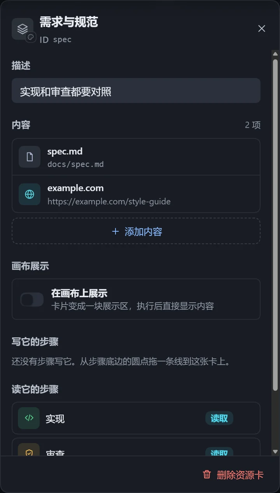

资源是画布上的独立卡片，用连线表示与步骤的读写关系。几个步骤连到同一个资源，它就是共用的一份。

| 类型 | 用途 |
|---|---|
| 文件 | 要读取、写入或更新的文件，如需求文档、报告。 |
| 文件夹 | 要读取或写入的目录。 |
| 网址 | 执行者会打开查看。 |
| Skill | 执行者先加载，再按它的做法完成任务。 |
| 自定义 | 一段自己写的提示词，读取它的步骤原样收到。 |

## 添加与连线

- 从步骤库「基础」拖出「资源」，或在空白处右键选择「资源」。
- 从步骤底部的圆点拖线到空白处，选择「产出文件」，得到一张由这一步写入的资源卡。
- 选中资源卡，点击「添加内容」，一张卡最多 50 项。

连线方向决定读写：

- 从**步骤**拖到资源卡：步骤**写入**。可选「整份写出」（覆盖）或「在原文件上更新」（先读再改，如在清单里打钩）。
- 从**资源卡**拖到步骤：步骤**读取**。
- 没有连任何步骤的资源交给整个工作流，所有步骤都能用。

## 内容怎么添加

| 类型 | 方式 |
|---|---|
| 文件、文件夹 | 在主机上选择；还没生成的产出文件可手填路径。 |
| 网址 | 填写地址。 |
| Skill | 从识别到的 Skill 中挑选，或手写名字。 |
| 自定义 | 写一段文字，最多 20000 字。 |

每一项可以单独写「说明」，告诉执行者怎么用；写入的文件可在说明里约定格式。「换颜色与类型」可把空卡换成「记忆」，见[记忆](/dsh-workflow-lite/materials/memory/)。

## 路径

- 绝对路径原样使用，不支持 `~`。
- 相对路径：有步骤写它时放在产出根目录下，只被读取时相对于工作区。
- 可用两个变量：

| 变量 | 换成 |
|---|---|
| `{workflow}` | 工作流自己的目录（默认 `~/.dsh/workflow-lite/assets/<工作流名>/`），在哪个工作区执行都是同一份，导出时一起带走。 |
| `{instance}` | 本次执行的实例编号，用在「产出根目录」，每次执行的产出各放一处。 |

## 注意

- 内容重复时提示「重复了」；Skill 在当前工作区找不到时，提示执行时可能加载不到。
- 在画布上直接预览文件，见[画布展示](/dsh-workflow-lite/display/overview/)。
