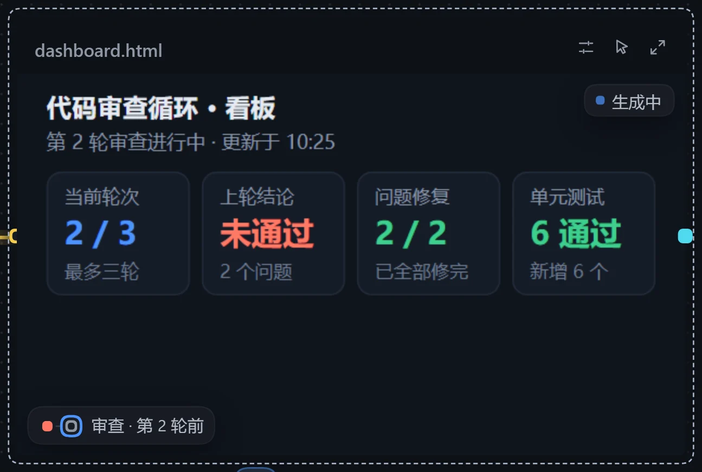
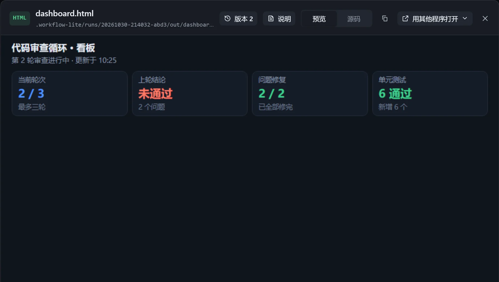
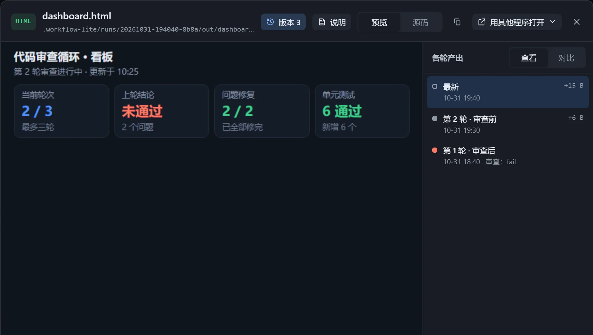

不必打开文件，在画布上就能看到最新结果，还能回头比较每一轮。

## 搭建

1. **让步骤产出一个成品文件**：在「汇总」等步骤的提示词和生成规则里写明文件（如 `dashboard.html` 或 `report.md`）、内容怎么组织，以及每轮覆盖同一个文件。
2. **变成资源卡**：从步骤右侧的点拖线到空白处，选「产出文件」。见[资源](/dsh-workflow-lite/materials/resources/)。
3. **打开展示**：选中资源卡，在右侧面板打开「在画布上展示」。

| 内容 | 建议 |
|---|---|
| 网页看板 | 选「大」，必要时调小缩放使整页可见。 |
| Markdown 报告 | 「中」或「大」。 |
| 图片 | 摆放用「适应」。 |

「让模型适配展示」默认开启，写文件的步骤会知道卡片多大。更多设置见[画布展示](/dsh-workflow-lite/display/overview/)。

## 执行与回看

打开「记录运行状态」后点击「执行」：写文件的步骤执行时卡片显示「正在生成」，写完换成最新内容并亮起「刚更新」。点击「交互」可在卡片内滚动，双击打开查看框。

有循环时，每做完一轮存一版，鼠标移到卡片上时底下出现一条刻度轴：悬停或拖动换到某一版，方向键也可切换；在查看框「版本」里可挑两轮对比。

详见[各轮产出回看](/dsh-workflow-lite/display/rounds/)。

## 注意

- 文件太大时显示「文件太大，画布上放不下」，可点开查看框，或让步骤产出精简些的版本。
- 在工作流画布（不是实例）上，卡片显示最近一次执行的内容。
- 各轮版本只在插件里执行时保存。
