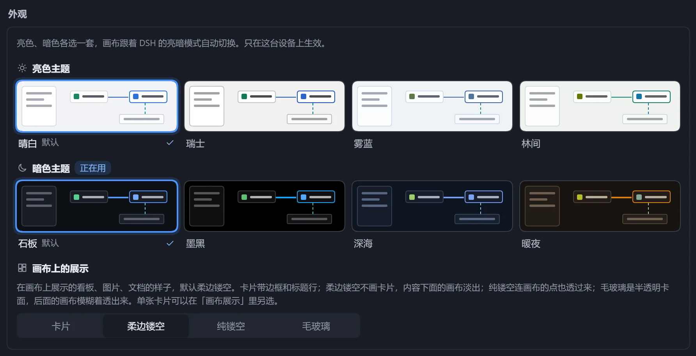
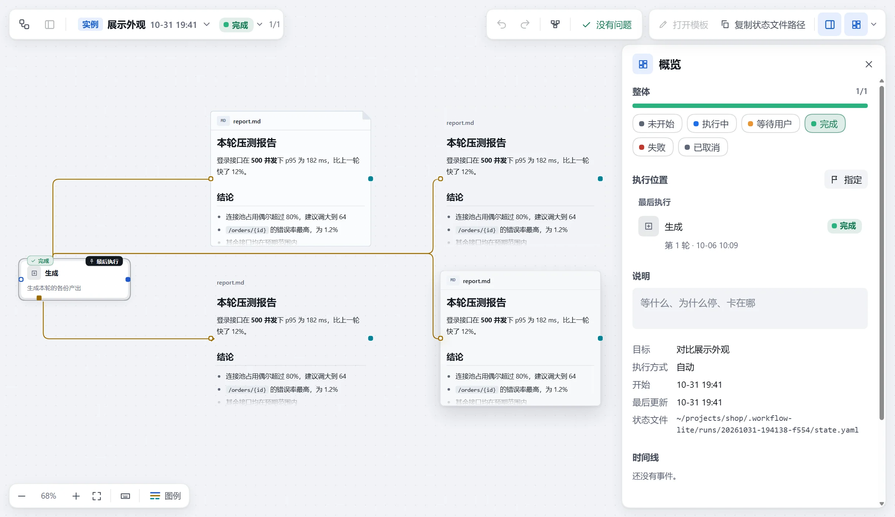

插件设置对所有工作流生效。打开「工作流中心」→「设置」，上方是「外观」（配色与展示卡外观），下方分「存储」「画布」「模型」三组。

## 使用

1. 修改设置项。
2. 底部出现「有 N 处改动还没保存」，点击「保存」，或「放弃」。
3. 与默认值不同的项右侧有「恢复默认」，悬停可看默认值。

标有「重启后生效」的项，保存后需重启 DSH。

## 设置项

| 分组 | 设置项 | 默认 | 效果 |
|---|---|---|---|
| 存储 | 数据目录 | `~/.dsh/workflow-lite` | 工作流、版本、实例记录存放处。重启后生效。 |
| 画布 | 单张工作流最多步骤 | 400 步 | 超出后不再自动整理，也不能执行。 |
| 画布 | 自动保存等待 | 400 毫秒 | 画布停手多久后写入磁盘。 |
| 模型 | 模型单次读取上限 | 256 KB | 模型读一张工作流或运行状态时最多拿到的内容，很大的工作流读取失败时调大。 |
| 模型 | 给模型的使用指南 | 开 | 注册三份模型按需读取的指南：设计工作流、记录运行状态、写画布看板。重启后生效。 |

## 注意

- 修改「数据目录」不会迁移已有数据，改回原路径即可重新看到。
- 输入不合要求时提示「要填整数」「不能小于 N」或「不能为空」，修正后才能保存。
- 当前 DSH 没有设置服务，或配置不允许在这里修改时，设置项为只读，页面顶部会说明原因。

## 外观

画布提供亮、暗各四套配色，跟随 DSH 的亮暗模式切换。选择只在当前设备生效，点击即应用。

### 选择主题

打开「工作流中心」→「设置」，在最上方的「外观」中分别选择「亮色主题」和「暗色主题」，当前使用的标有「正在用」。

| 亮色 | 特点 |
|---|---|
| 晴白（默认） | 浅灰画布、纯白卡面，对比最清楚。 |
| 瑞士 | 中性灰、直角细线、Helvetica 字体。 |
| 雾蓝 | 冷白底，蓝色点缀。 |
| 林间 | 暖白底，绿色点缀。 |

| 暗色 | 特点 |
|---|---|
| 石板（默认） | 冷调深石板灰。 |
| 墨黑 | 纯黑底，颜色更鲜亮，OLED 屏更省电。 |
| 深海 | 带蓝的深色底。 |
| 暖夜 | 带暖褐的深色底，琥珀橙强调。 |

### 画布上的展示

「画布上的展示」统一设置展示卡外观，默认「柔边镂空」；单张卡片可在「画布展示」里另选。四种外观见[画布展示](/dsh-workflow-lite/display/overview/)。

界面语言支持中文和 English，跟随 DSH 的语言设置。
