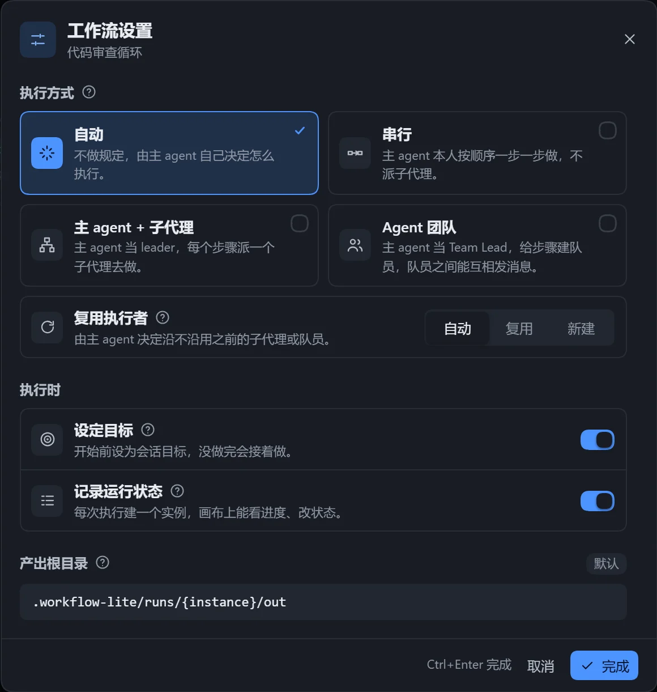

「工作流设置」控制单个工作流如何执行，每个工作流各有一份。点击画布工具栏的「工作流设置」打开。

| 设置项 | 可选值 | 默认 | 效果 |
|---|---|---|---|
| 执行方式 | 自动 / 串行 / 主 agent + 子代理 / Agent 团队 | 自动 | 主 agent 如何组织执行 |
| 复用执行者 | 自动 / 复用 / 新建 | 自动 | 同一步骤再次执行时是否沿用执行者 |
| 设定目标 | 开 / 关 | 开 | 把本次执行设为会话目标，没做完会接着做 |
| 记录运行状态 | 开 / 关 | 关 | 每次执行建一个实例，画布上看进度、改状态 |
| 产出根目录 | 相对或绝对路径 | `.workflow-lite/runs/{instance}/out` | 各步骤产出文件放这里 |

## 执行方式

| 选项 | 效果 |
|---|---|
| 自动 | 由主 agent 自己决定。 |
| 串行 | 主 agent 按顺序逐步完成，不派子代理。 |
| 主 agent + 子代理 | 主 agent 当 leader，每个步骤派一个子代理。 |
| Agent 团队 | 主 agent 当 Team Lead，为步骤建队员，队员之间可互发消息。 |

后两种方式下，主 agent 只负责派发、选分支、推进循环和汇报。子代理和团队依赖 DSH 的对应工具，不可用时会改为自己逐个执行。

## 复用执行者

「再次执行」包括循环下一轮、失败重试和中断后继续。

| 选项 | 效果 |
|---|---|
| 自动 | 由主 agent 决定。 |
| 复用 | 交回上次的执行者，接着之前的上下文，省去重新读取。 |
| 新建 | 每次派新的执行者，上下文干净，适合独立审查。 |

只在同一步骤间复用；执行方式为「串行」时不起作用。

## 设定目标

执行前把这次执行设为会话目标，主 agent 没做完就停下时，DSH 会让它接着做。会话里已有目标，或没有目标功能时自动跳过。

## 记录运行状态

开启后，每次编译会建一个实例：保存工作流快照，并在工作区 `.workflow-lite/runs/` 下建状态文件。执行期间只有主 agent 修改它；计划末尾会多一段「运行状态」。对下一次执行生效。见[实例与运行状态](/dsh-workflow-lite/running/run/#实例与运行状态)。

## 产出根目录

- 留空为默认目录，随实例各一份，不进版本库；`.` 表示工作区根目录。
- 相对路径以工作区为起点，可写绝对路径，不支持 `~`。
- `{instance}` 执行时换成实例编号。
- 保存时自动整理写法，「恢复默认」回到默认目录。
