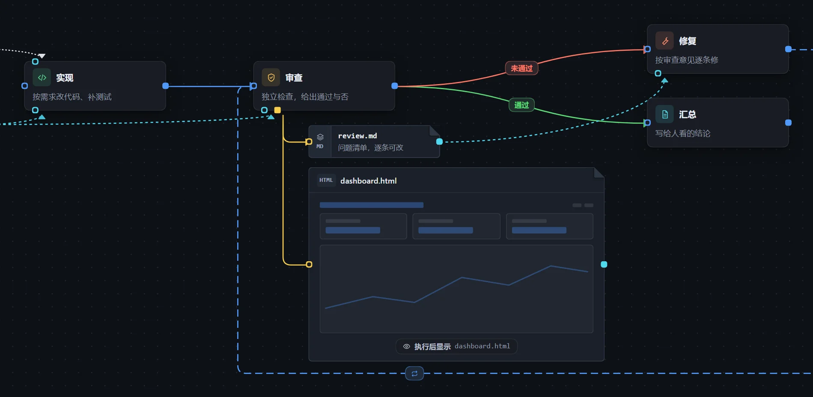
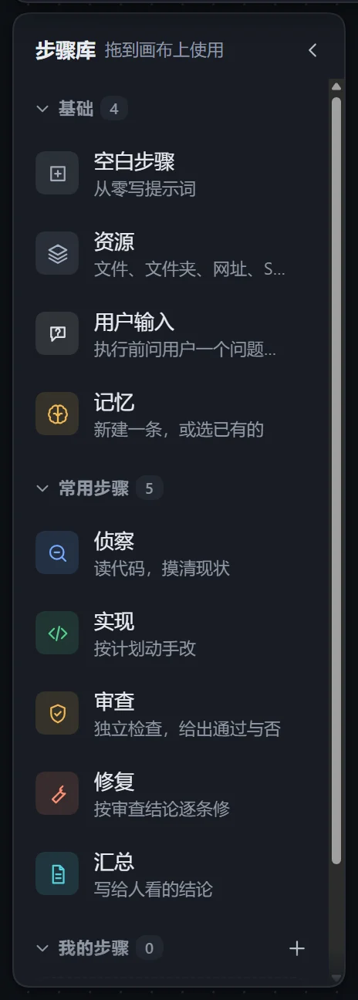
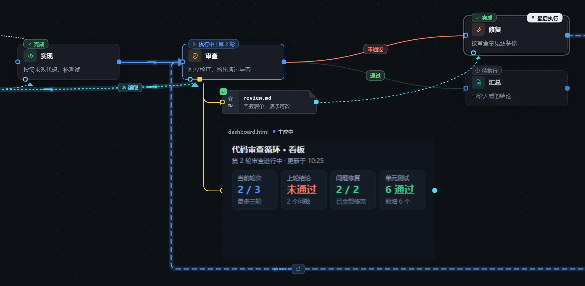

工作流由「步骤」和「连线」组成：步骤写明要做什么，连线决定先后，可以带条件，用来表示分支和循环。

## 让模型创建

在对话中描述流程，例如：

> 建一个工作流：先写代码，再审查，审查不通过就回去修复，最多三轮。

画布上会同步出现。确认无误后，点击右上角的「执行」。

## 手动编辑

1. 打开「工作流」标签页，新建一个工作流。
2. 把左侧步骤库里的步骤拖到画布上，填写提示词，再用连线连起来。
3. 点击「执行」。

## 查看进度

在「工作流设置」中打开「记录运行状态」，每次执行都会生成一个实例，画布随进度更新。

详见[工作流设置](/dsh-workflow-lite/settings/workflow/)。
