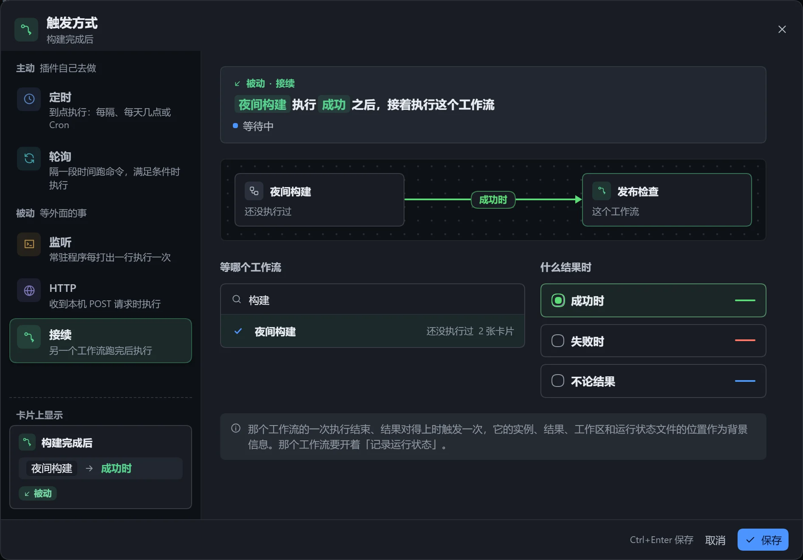

接续触发让工作流在另一个工作流的一次执行结束后自动执行，适合把构建、检查、发布串起来，或在失败后做善后。目前为实验性功能。

## 使用

1. 打开要等的那个工作流，在「工作流设置」里打开「记录运行状态」。
2. 在这个工作流里加一张触发卡片，点击「触发方式」卡头的「定时 ▾」，选「接续」。
3. 点击「选工作流」，「工作流」选要等的工作流，「结果」选什么结果时触发，点击「保存」。
4. 在「执行设置」里选会话方式和工作区，打开开关。卡片显示「等待中」。

那个工作流的一次执行结束、结果对得上时，这个工作流触发一次。背景信息里有那次执行的实例编号、结果、完成了几步、目标、工作区和运行状态文件的位置，模型需要那次的产出时会去读。

## 设置

| 配置项 | 可选值 | 默认 | 说明 |
|---|---|---|---|
| 工作流 | 除自己以外的工作流 | 无 | 要等的工作流，需开着「记录运行状态」。 |
| 结果 | 成功时、失败时、不论结果 | 成功时 | 「不论结果」包括取消。 |

一次执行算不算结束、结果是什么，以它运行状态里的整体状态为准：变成「完成」「失败」或「已取消」时算结束。在[工作流中心](/dsh-workflow-lite/manage/hub/#运行实例)手动改整体状态也算。

## 注意

- 只认打开开关之后结束的执行，之前结束的不补；每次执行只触发一次。
- 要等的工作流改名、删除或关掉「记录运行状态」后，卡片显示「设置不对」，重新选择或打开即可。
- 两个工作流互相等会来回触发，由「每小时触发上限」限住。
- 接续触发没有「过滤」；「触发条件」照常可用。
- 「立即触发一次」不等那个工作流，背景信息只有手填的那段。
