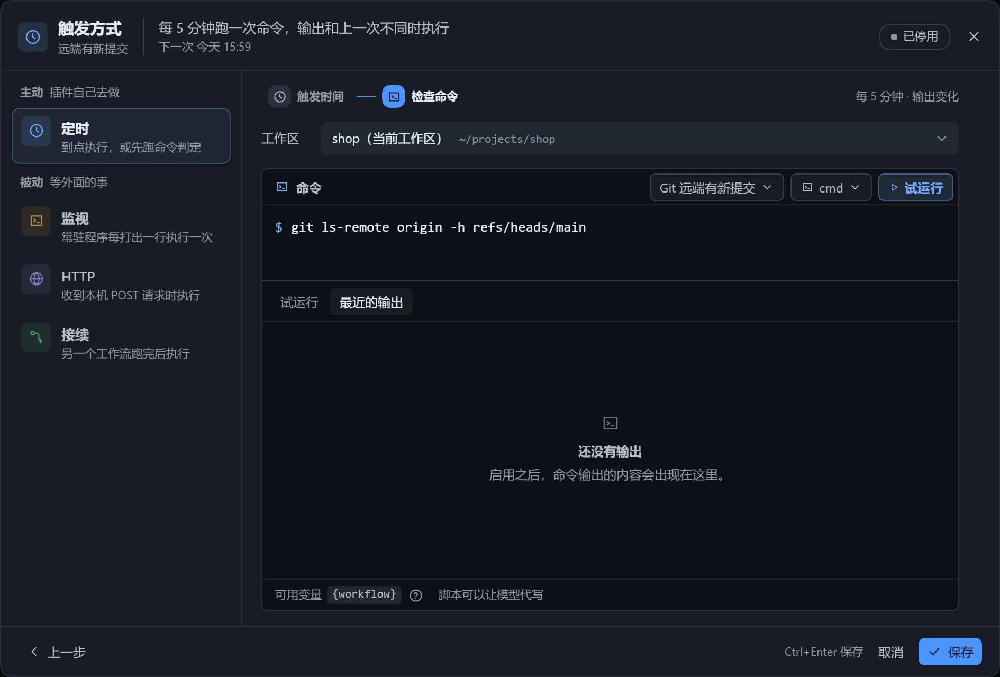
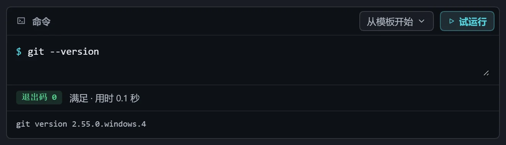

定时检查在每次到点时先在本机跑一条命令，按结果决定这一次执不执行，适合「远端有新提交」「网页能打开了」「文件夹里的文件变了」这类要查一下才知道的事。目前为实验性功能。

## 使用

1. 添加触发器，在「触发方式」里点击「编辑」，在「定时」页设好规则。
2. 「判定」选「每次成功」「变为成功」或「输出变化」。对话框分成「触发时间」「检查命令」两步，点击「下一步：检查命令」。
3. 选「工作区」，填写命令，或点「从模板开始」选一条再改；点击「试运行」看看输出。点击「保存」。
4. 打开「启用」，在浮出的确认卡里核对命令、工作区和 shell，点击「确认并启用」。

卡片显示「检查中」和上一次检查的结果，中间一行的进度条走到下一次检查。

| 判定 | 什么时候执行 | 背景信息 |
|---|---|---|
| 每次成功 | 退出码 0 就执行。 | 命令的标准输出 |
| 变为成功 | 由失败变为成功时执行一次；一直成功不重复执行。 | 命令的标准输出 |
| 输出变化 | 标准输出和上一次不同时执行。第一次只记下、不执行；失败的那次不比较。 | 新的标准输出 |

标准输出里有以 `::trigger::` 开头的行时，背景信息只取这几行（去掉标记），「输出变化」也只比较这几行；其余输出是日志，只显示在「最近的输出」里。

「判定」旁的示意画出连续几次检查里哪几次会执行，换一种判定随之变化。

## 命令

命令框顶上一排是「从模板开始」、所用的 shell 和「试运行」。

| 模板 | 判定 |
|---|---|
| Git 远端有新提交 | 输出变化 |
| 服务能访问了 | 变为成功 |
| 文件夹里的文件变了 | 输出变化 |
| 端口能连上了 | 变为成功 |

命令里可以写 `{workflow}`，运行前换成这个工作流的目录。脚本放在那里时写成 `node "{workflow}/triggers/check.mjs"`，换了工作区也找得到。脚本可以[让模型代写](/dsh-workflow-lite/trigger/model/)。

点击「试运行」并确认后，命令在所选工作区里用所选 shell 跑一次，下方写出退出码、按当前判定算成功还是失败、用时和输出；有 `::trigger::` 行时另写出有几行作为背景信息。试运行不启用、不发进会话。启用之后，同一处显示「最近的输出」。

## 设置

| 配置项 | 可选值 | 默认 | 说明 |
|---|---|---|---|
| 规则 | 间隔、时刻、Cron | 每天 09:00 | 带命令时「间隔」最短 10 秒。 |
| 判定 | 到点就执行、每次成功、变为成功、输出变化 | 到点就执行 | 选「到点就执行」就去掉命令，成为[定时触发](/dsh-workflow-lite/trigger/schedule/)。 |
| 工作区 | 已打开过的工作区 | 无 | 命令在这里运行，新会话也建在这里。 |
| Shell | 跟随默认、本机已有的 shell、选择其他 shell… | 跟随默认 | 「跟随默认」用[插件设置](/dsh-workflow-lite/settings/plugin/)里的「默认 shell」。 |

## 运行命令

- 命令以 DSH 的身份在所选工作区里运行，和在终端里自己跑一样，不进沙箱。启用前要确认命令；命令、工作区或 shell 改过之后，卡片显示「待确认」并停下，在面板里点击「确认命令」后继续。
- 命令要很快结束，不要等待输入。运行超过间隔（最长 5 分钟）算超时。
- 找不到命令、启动不了、超时算一次失败，连续失败达到「连续失败停用次数」后自动停用。退出码非 0 不算失败。

## 注意

- DSH 重启后接着上一次的结果判断，不会因为重启多触发一次。
- 「输出变化」比较整段输出：输出里带时间戳之类每次都变的内容时，每次都会触发：把关心的部分打成 `::trigger::` 行，或让脚本只打印关心的部分。
