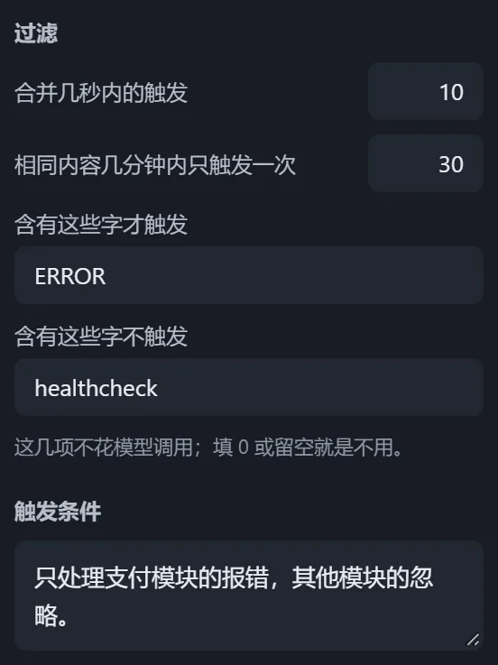

条件轮询、监听程序和 HTTP 触发都会带来背景信息。「过滤」在插件里直接筛掉不需要的触发，不花模型调用；「触发条件」交给模型读过内容再判断。

## 过滤

| 配置项 | 默认 | 说明 |
|---|---|---|
| 合并几秒内的触发 | 监听、HTTP 为 5 秒，轮询为 0 | 从第一次进来时起算，这段时间里的几次并成一次，背景信息按先后排列。 |
| 相同内容几分钟内只触发一次 | 0 | 内容完全相同的，这段时间里只算第一次。 |
| 含有这些字才触发 | 空 | 含有其中任意一个才触发，不区分大小写。 |
| 含有这些字不触发 | 空 | 含有其中任意一个就不触发，优先于上一项。 |

关键字用逗号、顿号或换行隔开；数字填 0 或留空就是不用。被过滤掉的触发不进触发记录。

## 触发条件

要读一下内容才能判断的，写在「触发条件」里，例如「只处理支付模块的报错」。写了之后，每次触发先由模型判断：

- 需要执行：照常开始工作流。
- 不需要执行：模型说明原因后结束，触发记录里这一次显示「模型判断不需要」和原因。

判断要用一次模型调用。能用关键字筛掉的先用过滤；要读文件、查资料才能判断的，做成工作流的第一步，用条件连线直接走到结束。

## 注意

- 背景信息很长时，发给模型的消息里只放开头，全文存成文件交给模型按需读取。
- 「立即触发一次」不经过过滤，触发条件照常由模型判断。
