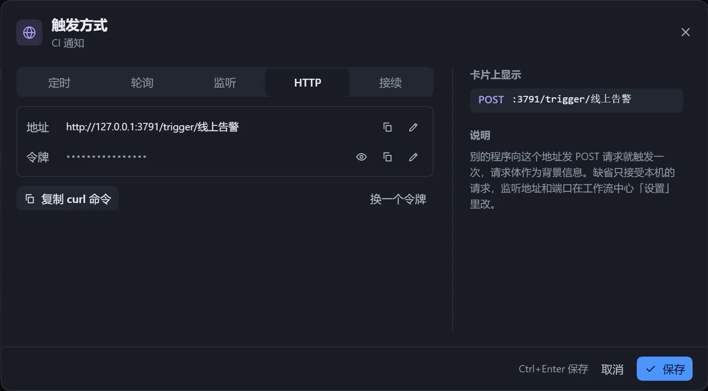

HTTP 触发给每张卡片一个地址和令牌，CI、脚本或别的工具向它发 POST 请求就触发一次，请求体作为背景信息。目前为实验性功能。



## 使用

1. 添加触发卡片，点击「触发方式」卡头的「定时 ▾」，选「HTTP」。
2. 在「执行设置」里选工作区，打开开关。卡片显示「接收中」。
3. 点击「触发方式」里的「编辑」，对话框里有「地址」和「令牌」；「调用示例」有 curl、PowerShell、JavaScript、Python 四种写法，已填好地址和令牌，点右上角复制。
4. 点击「发一条测试请求」，在浮出的小卡里点击「发送」。旁边显示返回码，202 表示收到，工作流照常触发一次。卡片开着、显示「接收中」时才能发。

地址默认用工作流名，如 `/trigger/巡检日报`；和别的卡片重名时接 `-2`。要改地址或令牌，点击对应行的铅笔，改完按 Enter 保存。

调用方式：

```sh
curl -X POST http://127.0.0.1:3791/trigger/<地址> \
  -H "Authorization: Bearer <令牌>" \
  -d '{"pipeline":"nightly","status":"failed"}'
```

请求一到就返回 202，不等工作流执行完。

| 返回 | 含义 |
|---|---|
| 202 | 收到，开始处理。 |
| 401 | 令牌不对。 |
| 404 | 地址不存在，或卡片没打开。 |
| 413 | 请求体超过 1 MiB。 |

## 设置

| 配置项 | 位置 | 默认 | 说明 |
|---|---|---|---|
| 地址 | 「触发方式」对话框 | 工作流名 | 字母、数字、中文和 `-` `_`，不能和别的卡片重。保存后旧地址马上失效。 |
| 令牌 | 「触发方式」对话框 | 随机生成 | 可以自己写，至少 16 个字，用字母、数字和 `-` `_` `.` `~`。保存后旧令牌马上失效。 |
| 换一个令牌 | 「触发方式」对话框 | — | 换成随机生成的新令牌，旧令牌马上失效，地址不变。 |
| HTTP 触发监听地址 | 工作流中心「设置」→「触发」 | 仅本机（127.0.0.1） | 选「所有网卡（0.0.0.0）」或某块网卡的地址后，别的机器也能调用；地址里显示的是那块网卡的地址。 |
| HTTP 触发端口 | 工作流中心「设置」→「触发」 | 3791 | 所有 HTTP 触发卡片共用；有打开的 HTTP 触发卡片时才占用。改了之后地址跟着变。 |

默认把 5 秒内的几次请求合并成一次，见[过滤与触发条件](/dsh-workflow-lite/trigger/filter/)。

## 注意

- 默认只接受本机（127.0.0.1）的请求。让别的机器调用时，请求走明文 HTTP，同一网络里的人能看到令牌；只在信得过的网络里使用，或放在 HTTPS 代理后面。
- 端口被别的程序占用、或所选网卡的地址不在了（换了网络）时，卡片显示「出错」并写明原因；空出来或在设置里换一个后自动恢复。
- 地址和令牌只存在本机，不随工作流导出；令牌泄露时点击「换一个令牌」。
