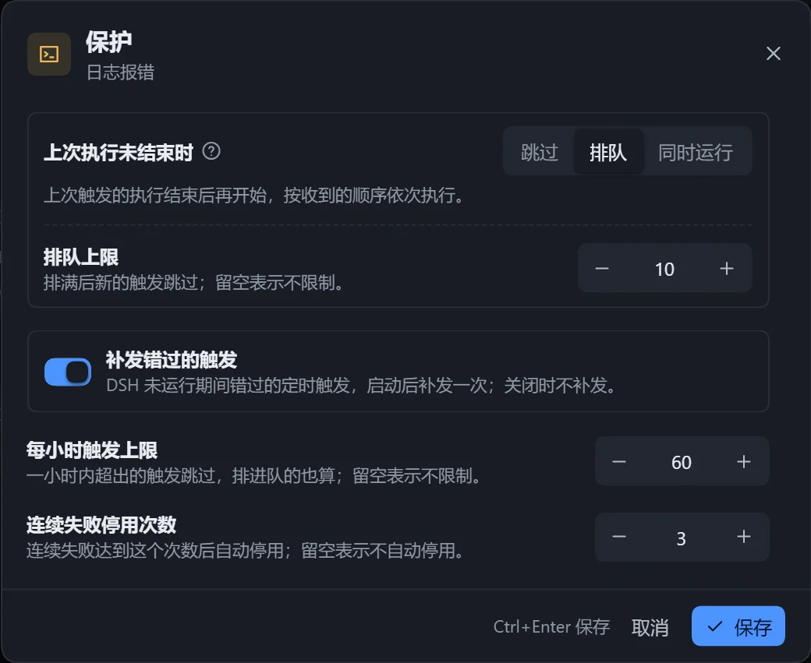

面板的「执行设置」决定触发后发进哪个会话，以及上一次执行还没结束时怎么办；「保护」防止触发太多或一直失败。各种触发方式通用。

## 会话

| 配置项 | 可选值 | 默认 | 说明 |
|---|---|---|---|
| 会话 | 新建会话、接着上一次、固定会话 | 新建会话 | 「接着上一次」发进上一次触发用的会话，它不在了就新建。 |
| 工作区 | 已打开过的工作区 | 无 | 新会话建在这里，命令也在这里运行。 |
| 固定到 | 已有的会话 | 无 | 选「固定会话」时出现，每次都发进这个会话。 |

工作区、会话只存在本机，不随工作流导出。

## 上次执行未结束时

在「执行设置」里点击「保护」那一行，在对话框里设置。

| 选项 | 效果 |
|---|---|
| 跳过（默认） | 上次触发的执行未结束时，本次跳过。 |
| 排队 | 上次触发的执行结束后再开始，按收到的顺序依次执行；排满「排队上限」（默认 10 个）后新的触发跳过。 |
| 同时运行 | 不等待上次执行，立即开始；修改同一工作区的工作流可能相互干扰。 |

是否结束看上次执行的运行状态：模型把整体状态改为完成、失败或取消才算结束；模型提问、等待回复时，以及已触发但模型还没开始执行时，都算未结束。所以选跳过或排队时，工作流要开启「记录运行状态」；没开时启用会先询问是否替它开启。

模型没有更新状态、上次执行一直未结束时，面板上会提示，点击「视为已结束」后排队的第一个立即发出，或下一次触发照常执行；上次执行不受影响。

排着的在卡片上显示「排队 N 个」，在[「触发」页](/dsh-workflow-lite/trigger/manage/)的「时间线」里列在「排队中」，可以取消某一次或全部清空。停用触发器时排着的不再执行，记成「跳过」。

## 保护

| 配置项 | 默认 | 说明 |
|---|---|---|
| 补发错过的触发 | 开 | DSH 未运行期间错过的定时触发，启动后补发一次；关闭时不补发。 |
| 每小时触发上限 | 60 | 一小时内超出的触发跳过，排进队的也算；留空表示不限制。 |
| 连续失败停用次数 | 3 | 连续失败达到这个次数后自动停用；留空表示不自动停用。 |

「失败」指触发器自己没干成：工作区或会话不存在、会话建不出来、工作流有错误无法执行、命令跑不起来、监视程序一启动就退出。跳过的、条件不满足的、被过滤掉的和发出去之后的执行结果都不算。

## 状态

卡片底部的「主动」表示由插件按时间发起（定时、定时检查），「被动」表示等外面的事发生才执行（监视、HTTP、接续）。

| 状态 | 含义 |
|---|---|
| 已停用 | 没有启用。 |
| 等待中 / 检查中 / 接收中 | 在正常运行，后面是下一次触发、上一次检查或启动的时间。 |
| 设置不对 | 规则、命令或要等的工作流有误，面板里写明原因。 |
| 待确认 | 要在本机运行的命令还没确认，或命令、工作区、shell 改过。 |
| 出错 | 常驻的部分出了问题，例如 HTTP 端口被占用。 |
| 已自动停用 | 连续失败达到次数，修好后重新启用。 |
| 已全部暂停 | 在「触发」页全部暂停着，启用状态不变。 |
| 由另一个 DSH 负责 | 同一个数据目录开着多个 DSH 时只有一个负责触发，它退出后由这里接手。 |
| 这里无法触发 | 当前环境不能新建会话或发消息。 |

## 触发记录与来源

面板的「触发记录」列出最近的触发和结果（已发出、排队中、跳过、失败、模型判断不需要），点一条查看原因和这次带的触发说明、背景信息，点击「看这次执行」打开那次执行；「全部记录」打开「触发」页。

每个实例都记录它是怎么发起的：在画布上打开实例时右侧面板的概览里，或工作流中心「运行实例」的「信息」里查看「来源」，是在画布上点「执行」、在对话里发起，还是由哪个触发器触发，以及触发时带的说明和背景信息。

## 注意

- 「立即触发一次」不看是否启用，不占每小时的次数，也不管上次执行有没有结束。
- 只在 DSH 运行期间触发，关闭后不会执行。
