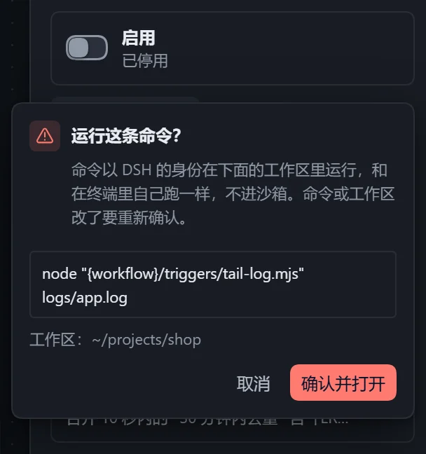

监视运行一条一直不退出的命令：启用时启动，停用时结束。程序往标准输出打出一行以 `::trigger::` 开头的内容就触发一次，标记后面的内容作为背景信息；其余输出都是日志，只显示在「最近的输出」里，不会触发。适合「日志里出现报错」「文件夹里有新文件」「消息队列来了消息」这类要一直盯着的事。目前为实验性功能。



## 使用

1. 添加触发器，在「触发方式」卡头的菜单里换成「监视」，点击「写命令」。
2. 选「工作区」，填写命令，或点「从模板开始」选一条再改；点击「保存」。
3. 打开「启用」，在确认卡里核对命令、工作区和 shell，点击「确认并启用」。

卡片显示「接收中」和程序启动的时间，中间一行换成最近一次事件的内容。「触发方式」对话框里命令框下方是「最近的输出」，包括错误输出；会触发的行前面标着 `::trigger::`。

模板有「文件夹里有新文件」「日志有新的一行」和「工作流里的脚本」（运行工作流目录里的 `triggers/watch.mjs`）。保存之前可以点击「试运行」：确认后程序在所选工作区里跑 5 秒，结果写出这段时间打出了几行 `::trigger::`，一行都没有时提示启用后不会触发；下面是全部输出，一件事被换行断开时，没带标记的那几行标成黄色。试运行不启用、不发进会话。

日志一次刷出很多行时，用[过滤](/dsh-workflow-lite/trigger/filter/)把它们合并、去重或按关键字筛掉；默认把 5 秒内的几行合并成一次。

## 程序的写法

```js
// 一件事一行：换行换成 ⏎，后面可以跟一段 JSON
const emit = (text, data) => {
  const line = data === undefined ? String(text) : `${text} ${JSON.stringify(data)}`
  console.log(`::trigger:: ${line.replace(/\r?\n/g, ' ⏎ ')}`)
}
console.log('开始监视') // 日志：不触发
emit('D:/inbox 进了新文件 report.csv', { size: 20481 }) // 触发一次
```

- 要触发的那一行以 `::trigger::` 开头，后面一句话说清这件事，日志原文、消息正文这类内容直接拼进来；格式不限，纯文字、文字加 JSON 都可以。
- 一件事只占一行：内容里的换行要先去掉，否则后面几行不带标记，只算日志。
- 字段是什么意思、每次都一样的要求写进「触发说明」，不用每行都带。
- 启动提示、进度、第三方库的输出照常打印，都只是日志。
- 启动时先记下现状，不打 `::trigger::` 行；之后出现的新事件才打。
- 打完一行马上刷新输出，例如 Python 用 `print(..., flush=True)`。
- 一直运行，不要自己转到后台（不用 `&`、`nohup`、`start`）。
- 优先用 Node 写脚本，各系统都能运行；命令写成 `node "{workflow}/triggers/watch.mjs"`，`{workflow}` 换成工作流目录。

脚本可以[让模型代写](/dsh-workflow-lite/trigger/model/)。命令的运行方式、确认和 shell 与[定时检查](/dsh-workflow-lite/trigger/check/#运行命令)相同。

## 状态

| 状态 | 含义 |
|---|---|
| 接收中 | 程序在运行。 |
| 重启中 | 程序意外退出，后面是下一次重启的时间。等待从 2 秒起逐次加倍，最长 1 分钟。 |
| 待确认 | 命令、工作区或 shell 改过，在面板里点击「确认命令」后继续。 |

程序启动后不到 1 分钟就退出算一次失败（脚本有错、命令不存在、依赖没装），连续失败达到「连续失败停用次数」后自动停用；运行满 1 分钟后失败次数清零。

## 注意

- 现成的命令行工具（如 `tail -f`、`mosquitto_sub`）打出的行不带标记，直接当命令用不会触发：用脚本把它作为子进程运行，给要触发的行加上 `::trigger::`。
- 停用触发器、关闭 DSH 时，程序连同它启动的子进程一起结束。
- 超过「每小时触发上限」的直接丢掉，触发记录里每 10 分钟只记一条「跳过」。
