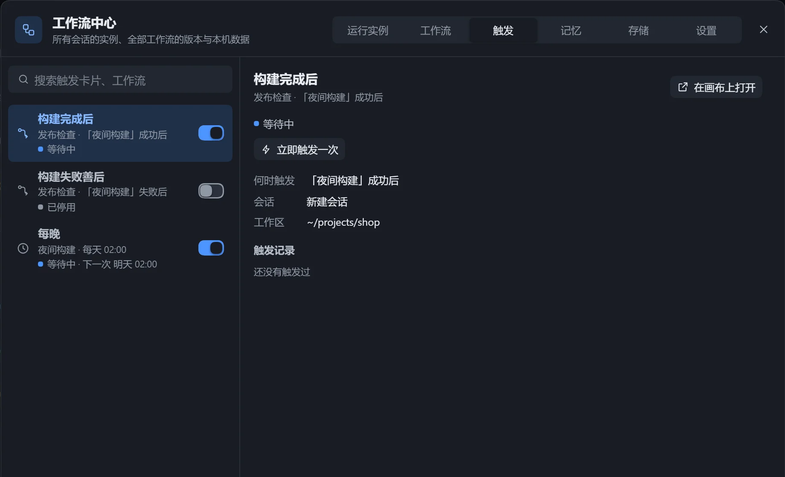
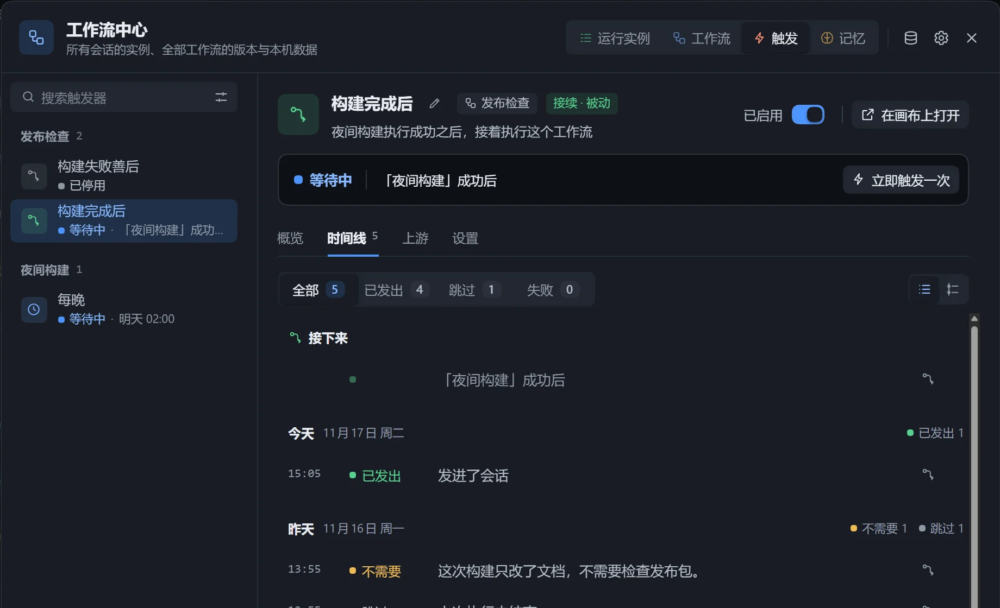

工作流中心的「触发」页列出所有工作流里的触发器，可以在一处查看状态、启用或停用、看触发记录，也可以全部暂停。

## 使用

1. 点击画布左上角的「工作流中心」，切到「触发」。在触发器面板里点击「全部记录」，会直接打开这里并选中它。
2. 左边默认按状态分组，「待处理」排在最前，组内按名称排序。点「视图选项」可以改分组、排序、筛选和行高。
3. 点一行，右边顶部是名称、触发方式和一句话说明，右侧是启用开关和「在画布上打开」；下面一条写着现在的状态和下一次时间，带「立即触发一次」。
4. 有问题时状态条写明原因并给出处理按钮，例如「确认并启用」「重新启用」「视为已结束」。
5. 点击「在画布上打开」，切到那个工作流并选中这个触发器，在那里修改设置。

## 页签

| 页签 | 内容 |
|---|---|
| 概览 | 近 7 天触发次数和结果，「节律」按小时画出近 7 天每次触发，以及今天还要触发的和最近几条记录。 |
| 时间线 | 全部触发记录，可按结果筛选，在「清单」和「时间轴」两种样子间切换；排队中的和接下来的排在前面。 |
| 日程 / 输出 / 调用 / 上游 | 随触发方式而变：定时是接下来 7 天，定时检查和监视是最近的输出，HTTP 是地址、令牌和调用示例，接续是要等的工作流和它最近的执行。 |
| 设置 | 这个触发器的触发方式、触发处理、执行设置和本机设置，只读；修改要到画布上。 |

点一条记录查看原因全文和这次触发带的触发说明、背景信息；点记录右侧的「看这次执行」打开那次执行。

## 全部暂停

左栏底部的「全部暂停」让所有触发器暂时不再自动触发，各自的启用状态不变。

| 触发方式 | 暂停期间 |
|---|---|
| 定时 | 到点不触发。 |
| 定时检查、监视、HTTP | 停止运行；HTTP 端口释放。 |
| 接续 | 那边结束的执行不触发。 |

启用着的触发器显示「已全部暂停」，排队中的也先不发。点击「恢复」后照常运行，暂停期间错过的不补；「立即触发一次」不受暂停影响。

## 注意

- 暂停对同一个数据目录下的所有 DSH 都生效，重启后仍然暂停着。
- 只想停一个触发器时，停用它即可。
