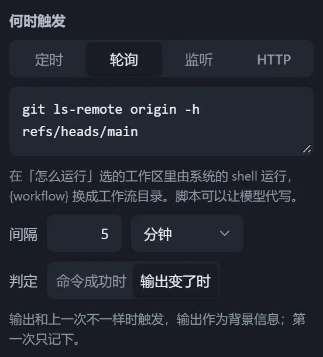
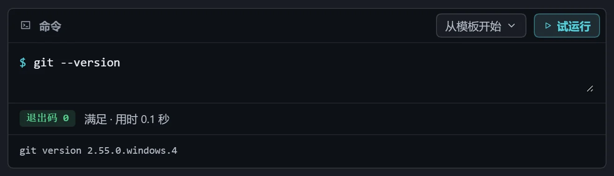

条件轮询每隔一段时间在本机跑一条命令，按结果决定这一次触不触发，适合「远端有新提交」「网页内容变了」「文件出现了」这类要查一下才知道的事。目前为实验性功能。

## 使用

1. 添加触发卡片，点击「触发方式」卡头的「定时 ▾」，选「轮询」。
2. 点击「写命令」，在「间隔」里点一档（别的间隔点「自定义…」填写），在「判定」里选方式，在「工作区」里选命令运行的目录。
3. 填写「命令」，或点「从模板开始」搜索、选一条再改；点击「保存」。
4. 打开开关，在弹出的确认卡里核对命令和工作区，点击「确认并打开」。

「判定」旁边的示意画出连续 6 次检查里哪几次会执行，换一种判定随之变化。「工作区」和「执行设置」里的是同一项，新会话也在这里打开；改了工作区，保存后要重新确认命令。

卡片显示「检查中」和上一次检查的结果，中间一行的进度条走到下一次检查。点击「触发方式」里的「编辑」，命令框下方是命令最近几次的输出。

## 试运行

保存之前可以先跑一次命令看看：点击「命令」框右上角的「试运行」，在浮出的小卡里确认后，命令在所选的工作区里运行（没选时用当前会话的工作区）。结果栏写出退出码、按「执行成功」算成功还是失败和用时，下面是输出。试运行不会打开卡片，也不会触发工作流；改了命令后上一次的结果收起。

## 设置

| 配置项 | 可选值 | 默认 | 说明 |
|---|---|---|---|
| 命令 | 一条命令 | 空 | 由系统的 shell 运行（Windows 是 cmd，其余是 sh）。可以写变量 `{workflow}`，运行前换成这个工作流的目录，脚本放在那里时写成 `node "{workflow}/triggers/check.mjs"`。 |
| 间隔 | 常用 1 分钟、5 分钟、15 分钟、1 小时、1 天；「自定义…」可填 10 秒到 7 天 | 5 分钟 | 每次跑完后隔多久再跑；打开开关时马上跑一次。 |
| 判定 | 执行成功、输出变化 | 执行成功 | 见下表。 |
| 工作区 | 侧栏里各会话所在的目录 | 无 | 命令在这里运行；没选时试运行用当前会话的工作区，打开开关前要选好。 |

| 判定 | 触发方式 | 背景信息 |
|---|---|---|
| 执行成功 | 退出码 0 为成功。由失败变为成功时执行一次；一直成功不重复执行。 | 命令的标准输出 |
| 输出变化 | 标准输出和上一次不同时执行。第一次检查只记下输出、不执行；退出码非 0 的那次不比较。 | 新的标准输出 |

过滤、触发条件见[过滤与触发条件](/dsh-workflow-lite/trigger/filter/)，会话方式和保护见[定时触发](/dsh-workflow-lite/trigger/schedule/)。

## 运行命令

- 命令以 DSH 的身份在所选工作区里运行，和在终端里自己跑一样，不进沙箱。打开开关前要确认命令；命令或工作区改过之后，卡片显示「待确认」并停下，在面板里点击「确认命令」后继续。
- 命令要很快结束，不要等待输入。运行时间超过间隔（最长 5 分钟）算超时。
- 找不到命令、启动不了、超时算一次失败，连续失败达到「连续失败停用次数」的次数后自动停用。命令退出码非 0 不算失败。
- 脚本可以让模型代写：在对话里说明想在什么时候执行这个工作流，模型会把脚本放进工作流目录、先试跑，再加一张关着的触发卡片；检查后选好工作区并打开开关。

## 注意

- DSH 重启后接着上一次的结果判断，不会因为重启多触发一次。
- 「输出变化」比较的是整段输出：输出里带时间戳之类每次都变的内容时，每次都会触发，可以让脚本只打印关心的部分。
