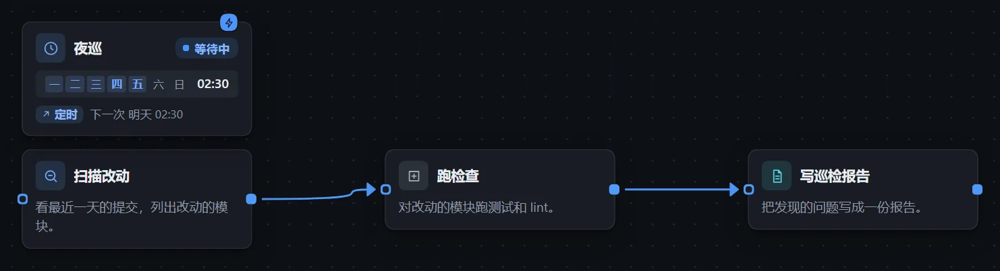
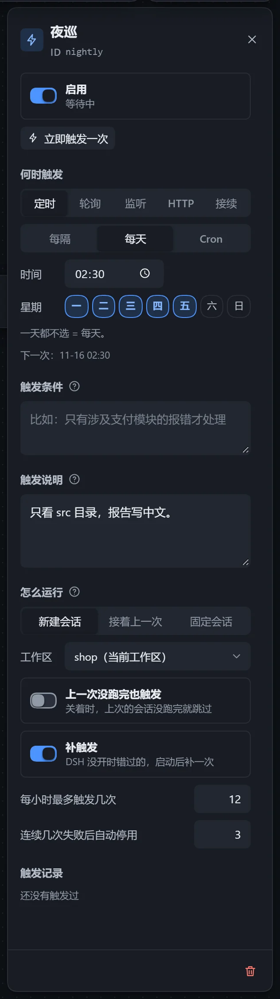
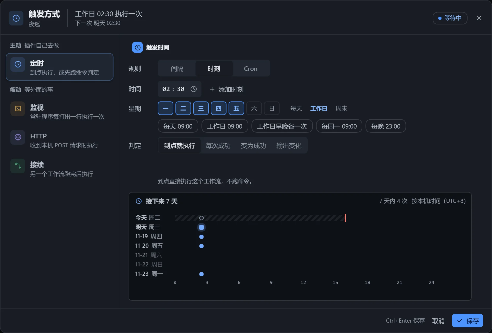

触发器让工作流在某件事发生时自动执行：插件把工作流发进一个会话，由模型照常执行。目前为实验性功能。

| 触发方式 | 什么时候执行 | 见 |
|---|---|---|
| 定时 | 到点执行 | 本页 |
| 定时 + 检查命令 | 到点先跑一条命令，按结果决定 | [定时检查](/dsh-workflow-lite/trigger/check/) |
| 监视 | 常驻程序打出一行 `::trigger::` | [监视](/dsh-workflow-lite/trigger/listen/) |
| HTTP | 别的程序发来请求 | [HTTP 触发](/dsh-workflow-lite/trigger/http/) |
| 接续 | 另一个工作流跑完 | [接续触发](/dsh-workflow-lite/trigger/after/) |

会话、工作区、上次执行未结束时怎么办、保护和状态各种方式通用，见[执行设置与保护](/dsh-workflow-lite/trigger/launch/)。

## 使用

1. 从步骤库「基础」拖出「触发」，或在画布空白处右键添加。触发器不连线，触发的是整个工作流。
2. 新触发器默认是「定时」、每天 09:00。在右侧面板的「触发方式」里点击「编辑」，设好规则，点击「保存」。
3. 在「执行设置」里选会话方式和工作区。
4. 打开面板顶部的「启用」。卡片标题右边显示「等待中」，底部是下一次触发的时间。

想马上看效果，点击面板里的「立即触发一次」，在浮出的小卡里可以写这一次附带的背景信息，再点击「触发」。

「触发方式」是一张和画布卡片同样子的卡：点卡头的触发方式在菜单里换一种，直接生效、可以撤销；点「编辑」打开对话框改详细设置。换到还差东西的方式时，「编辑」变成「写命令」或「选工作流」。

## 「触发方式」对话框

左栏列出四种触发方式，分「主动」（插件按时间自己去做）和「被动」（等外面的事），点一种就换过去。标题旁用一句话写明这个触发器什么时候执行；有没保存的改动时写「有改动，保存后生效」。

「定时」页上半是规则，「判定」选「到点就执行」就是本页的定时；下方「接下来 7 天」按本机时间画出每次触发的时刻，规则写没写对一看便知。

点击「保存」（Ctrl+Enter）才生效；有没保存的改动时，按 Esc 或点对话框外面不会关掉，要点「取消」。选中画布上的触发器后，点卡片中间那一行也能打开这个对话框。

## 设置

| 规则 | 可选值 | 常用 |
|---|---|---|
| 间隔 | 1 分钟到 7 天，从启用的时刻起算 | 1 分钟、15 分钟、1 小时、1 天 |
| 时刻 | 一天里的几个时刻（最多 12 个），可只选星期几，有「每天」「工作日」「周末」三个快捷项 | 每天 09:00、工作日 09:00、工作日早晚各一次、每周一 09:00、每晚 23:00 |
| Cron | 分、时、日、月、周五格，按本机时区；点哪一格就说明那一格怎么写，写错只标出那一格；可以把整条表达式粘贴进任意一格 | 工作日 09:00、工作时间每 15 分钟、每月 1 日 09:00 |

## 注意

- 只在 DSH 运行期间触发。DSH 没开着时错过的，启动后是否补发一次由「补发错过的触发」决定，见[保护](/dsh-workflow-lite/trigger/launch/#保护)。
- 启用状态、工作区和会话只存在本机，不随工作流[导出](/dsh-workflow-lite/manage/import-export/)；导入后要重新选择并启用。
- 加了触发器的工作流不要用 0.10.0 及更早版本的插件打开，保存后触发设置会丢失。
